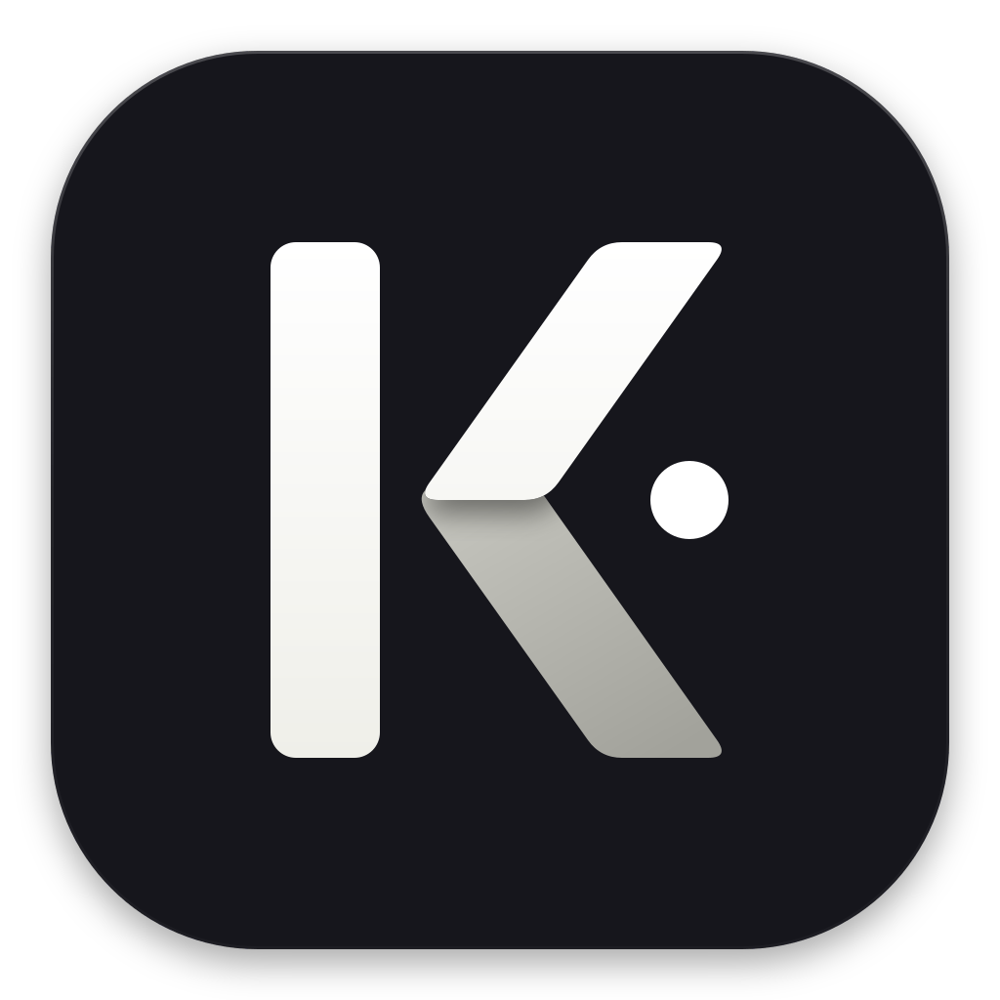
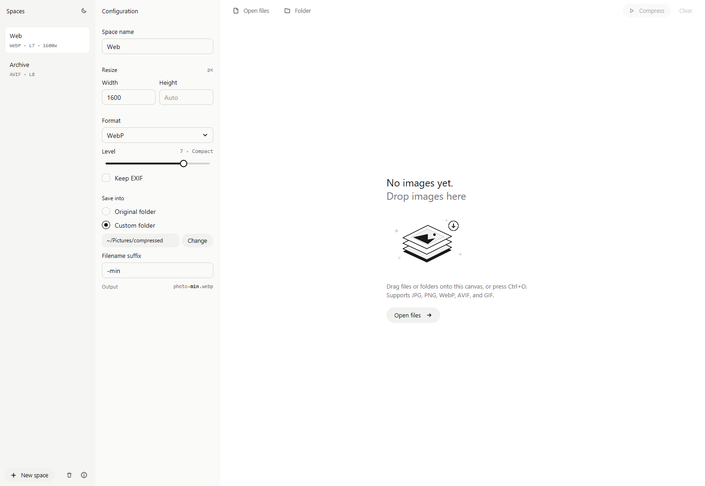

<div align="center">
  
  <h1>Kilo</h1>
  <p>Fast, local-first batch image compression for desktop.</p>
  <p>
    <a href="https://github.com/richhost/kilo/releases">Download</a> ·
    <a href="#features">Features</a> ·
    <a href="#keyboard-shortcuts">Shortcuts</a> ·
    <a href="#development">Development</a> ·
    <a href="./LICENSE">License</a>
  </p>
</div>

<picture>
  <source media="(prefers-color-scheme: dark)" srcset="./assets/preview-dark.png" />
  <source media="(prefers-color-scheme: light)" srcset="./assets/preview-light.png" />
  
</picture>

## Features

- **Local-first & private** — All compression runs on your machine via [`sharp`](https://github.com/lovell/sharp) (`libvips`). Images and metadata are never uploaded.
- **Reusable Spaces** — Create separate preset spaces with their own target format, quality level (`1–9`), resize bounds (`Width` / `Height` in `px`), EXIF toggle, save destination (`Original folder` or `Custom folder`), and filename suffix.
- **5 formats supported** — Optimize **JPG**, **PNG**, **WebP**, **AVIF**, and **GIF** by dragging files or folders onto the canvas or browsing from the toolbar.
- **Safe output handling** — Live output filename preview, automatic duplicate-name deduplication, and inline warnings whenever a preset would overwrite source files.
- **Batch insights & quick actions** — Per-file and overall byte savings summaries, one-click reveal in folder, clipboard file copy, retry for failed items, and safe move-to-trash deletion.
- **Native GPUI interface** — Powered by Svelte 5 and [`gpuix-svelte`](https://github.com/khromov/gpuix-svelte) without an Electron/Chromium shell, featuring virtualized list scrolling, synchronized Light/Dark modes, and the bundled [Allo](https://allo.joshpuckett.me/) typeface.

## Keyboard Shortcuts

| Windows / Linux | macOS | Action |
| --- | --- | --- |
| `Ctrl+O` | `⌘O` | Open image files |
| `Ctrl+Shift+O` | `⌘⇧O` | Open folder (recursive scan) |
| `Ctrl+Enter` | `⌘⏎` | Re-compress active Space queue |
| `Esc` | `Esc` | Dismiss active menu, popover, or dialog |

## Install

Download prebuilt binaries for Windows (`x64` / `arm64`), macOS (`Apple Silicon`), and Linux (`x64`) from [GitHub Releases](https://github.com/richhost/kilo/releases).

> Existing PixZip Lite users keep their Spaces automatically: Kilo reads previous `pixzip-lite` settings on first launch if no `kilo` config exists yet.

## Development

Requires [Bun](https://bun.sh) (`>= 1.4.0`, needed for single-file binary builds) or Node.js (`>= 24.0.0`).

```bash
bun install

# Launch native GPUI window with hot reload
bun run start

# Typecheck TypeScript and Svelte components
bun run typecheck

# Run unit, platform, and headless GPUI tests
bun run test

# Build standalone single-file executable in dist/
bun run build

# Build executable, release zip archive, and update manifest fragment
bun build.ts --archive
```

## Architecture

- `app.ts` / `standalone.ts` — Dev (`render_hot`) and production (`render`) desktop entrypoints.
- `App.svelte` — Root 3-pane layout shell, window bounds persistence, theme sync, global shortcuts, and font registration.
- `build.ts` — Embeds target `sharp` / `libvips` binaries and bundled fonts into `dist/`.
- `test.ts` — Self-contained verification suite using `gpuix-svelte/test`.
- `src/core/` — Pure Node/Sharp domain engine (`types.ts`, `scan.ts`, `paths.ts`, `compress.ts`).
- `src/platform/` — OS integrations (native clipboard copy, asset extraction, font registration, and Windows DWM titlebar sync).
- `src/state/` — Svelte 5 runes stores (`spaces.svelte.ts`), compression queue, thumbnail cache, and UI actions.
- `src/ui/` — Achromatic Ink & Paper theme tokens, vector icons, and GPUI-native Svelte components.
- `assets/` — App icon (`icon.svg`, `icon.png`), bundled [Allo](./assets/fonts/OFL.txt) font weights, and previews.

## Acknowledgments

- [Svelte](https://github.com/sveltejs/svelte), [gpuix-svelte](https://github.com/khromov/gpuix-svelte), [sharp](https://github.com/lovell/sharp), and [Allo](./assets/fonts/OFL.txt) (`SIL OFL 1.1`).
- Supported by JetBrains Open Source:

  [](https://www.jetbrains.com/?from=pixzip)

## Support & License

Released under the [MIT License](./LICENSE). If Kilo saves you time, you can support ongoing development via [Ko-fi](https://ko-fi.com/abieeyang) or [Afdian](https://afdian.com/a/abiee).
